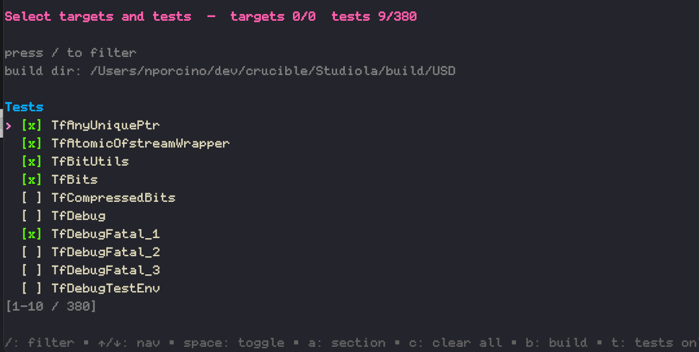

# bnt — build-and-test for CMake

## OVERVIEW

`bnt` is a small Go tool that wraps `cmake --build` and `ctest`. 

To use it, run from a CMake source directory - there's a number of command line switches to run directly, or run without parameters to use it as an interactive tool.

Currently, `bnt` is a bit MacOS specific; it repairs rpaths and signing to get past typical MacOS command line stumbling blocks encountered on complex projects like OpenUSD.

## PROVENANCE

Unless locally overridden, the following Provenance Node applies to all files
```
╭──────────────────────────────────────────────────────────────────────────╮
│ PROVENANCE NODE 000-1                                                    │
│ SCOPE  : https://github.com/meshula/bnt                                  │
├───────────────────────────────────┬──────────────────────────────────────┤
│ PARENT : NONE                     │ SCHEMA : V-1-0                       │
├───────────────────────────────────┼──────────────────────────────────────┤
│ AUTH_ID  : NICK PORCINO           │ DATE        : 2026-08-06             │
│ SRC_AUTH : HUMAN_IN_LOOP          │ TRANSFORMER : QWEN3.6 27B-A3B        │
├───────────────────────────────────┼──────────────────────────────────────┤
│ INDEX_ALLOW : YES                 │ CORP_TRAIN : NO                      │
│ DERIV_ALLOW : YES                 │ GOV_SPDX   : BSD-2-CLAUSE            │
├───────────────────────────────────┴──────────────────────────────────────┤
│ HASH   : UNSIGNED                                                        │
╰──────────────────────────────────────────────────────────────────────────╯
```

## Install

Build in place:

```sh
cd ~/dev/bnt
go build -o bnt .
```

Or use the Makefile to build and install onto your `PATH`:

```sh
make install                 # -> /usr/local/bin/bnt
make install PREFIX=~/.local # -> ~/.local/bin/bnt
sudo make install            # if /usr/local needs root
```

`make install` honors the standard `PREFIX` (default `/usr/local`) and `DESTDIR`
variables, installing the binary to `$(DESTDIR)$(PREFIX)/bin/bnt`. Other targets:
`make` (build), `make test`, `make vet`, `make uninstall`, `make clean`.

## Usage

```
bnt [flags]
```

With no `--build`/`--test` flags, `bnt` launches interactively. The interactive mode has interactive help.

Using the `--build` flag and/or the `--test` flag, `bnt` runs headless and exits with the underlying tool's status.

### Flags

| flag | description |
|---|---|
| `--source DIR` | source dir, default cwd |
| `--build-dir DIR` | CMake build dir (required headless) |
| `--install-dir DIR` | optional `cmake --install` destination |
| `--build TARGET` | build target (repeatable) |
| `--test REGEX` | ctest regex (repeatable; joined as alternation) |
| `--jobs N` | parallel jobs, default `nproc` |
| `--fix-rpath` | macOS: swap Python.framework rpath on test binaries |
| `--rpath-old PATH` | rpath to remove (default `/Library/Frameworks/Python.framework`) |
| `--rpath-new PATH` | rpath to add (default `/Library/ManagedFrameworks/Python/Python3.framework`) |
| `--test-bin-dir DIR` | dir holding test binaries to patch (default `<build-dir>/../tests`) |
| `--verbose` | `ctest -V` |

### Example: reproduce `bnt.sh`

```sh
cd ~/dev/OpenUSD
bnt --build-dir ~/local-usd/build/OpenUSD \
    --install-dir ~/local-usd/build/OpenUSD/pxr/usd/usdProfiles \
    --build usdProfiles --build _usdProfiles \
    --build testUsdProfilesRegistry \
    --build testUsdProfilesProfiles --build testUsdProfilesClaimsAPI \
    --test testUsdProfiles --fix-rpath --verbose
```

## Interactive Tool

### Remembering the last run

The interactive flow remembers the last build/test configuration in a
`.bnt.json` dot file in the current directory (headless runs never write it).
On startup, if that file exists, `bnt` prints a short summary and offers to
replay it:

```
remembered configuration (.bnt.json):
build dir:   /Users/me/local-usd/build/OpenUSD
install dir: (none)
  target: usdProfiles
  test:   testUsdProfiles
use configuration from dot file? (b/t/n):
```

- `b` — replay **build + test** (straight to running, no UI).
- `t` — replay **test-only** (skip the build, just run ctest with fix-rpath).
- `n` — ignore the dot file and start the interactive flow.

The summary lists up to 16 target/test lines; beyond that it ends with `…N others`.

### Interactive flow

When there's no dot file (or you answered `n`):

1. **CMake build directory** — a stdin prompt. Type a path (with `~/` expansion),
   or press **Enter on a blank line to open a directory picker** and browse to it.
   Cancelling the picker (`q`) exits without building.
2. **Install?** — answer `y` to install; anything else (including blank) skips it.
   If you answer `y`, you get an install-directory prompt with the same
   blank-line→picker behavior.
3. The **target/test checklist** then appears (unchanged): pick targets and tests,
   `b` to build (and run any checked tests), `t` to run checked tests only.



The resulting test run looks like:

```
Test project /Users/nporcino/dev/crucible/Studiola/build/USD
      Start 16: TfException
 1/10 Test #16: TfException ......................   Passed    1.14 sec
      Start 17: TfFileUtils
 2/10 Test #17: TfFileUtils ......................   Passed    1.07 sec
      Start 19: TfAtomicOfstreamWrapper
 3/10 Test #19: TfAtomicOfstreamWrapper ..........   Passed    0.08 sec
      Start 21: TfAnyUniquePtr
 4/10 Test #21: TfAnyUniquePtr ...................   Passed    0.06 sec
      Start 22: TfBits
 5/10 Test #22: TfBits ...........................   Passed    0.06 sec
      Start 23: TfBitUtils
 6/10 Test #23: TfBitUtils .......................   Passed    0.06 sec
      Start 26: TfDebugFatal_1
 7/10 Test #26: TfDebugFatal_1 ...................   Passed    0.06 sec
      Start 32: TfDelegate
 8/10 Test #32: TfDelegate .......................   Passed    1.26 sec
      Start 33: TfDiagnosticTransport
 9/10 Test #33: TfDiagnosticTransport ............   Passed    0.08 sec
      Start 70: TfDelegatedCountPtr
10/10 Test #70: TfDelegatedCountPtr ..............   Passed    0.07 sec

100% tests passed, 0 tests failed out of 10
```
